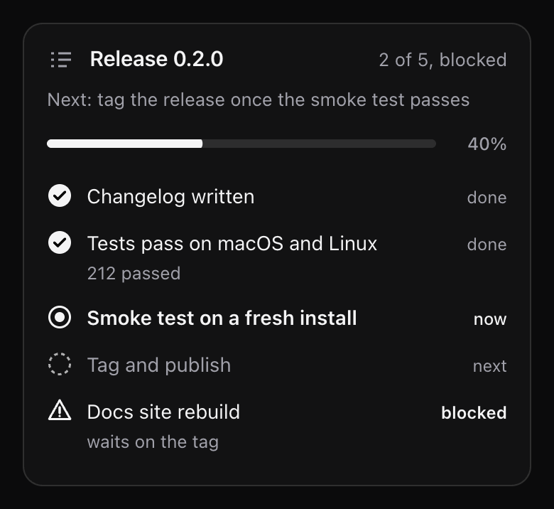
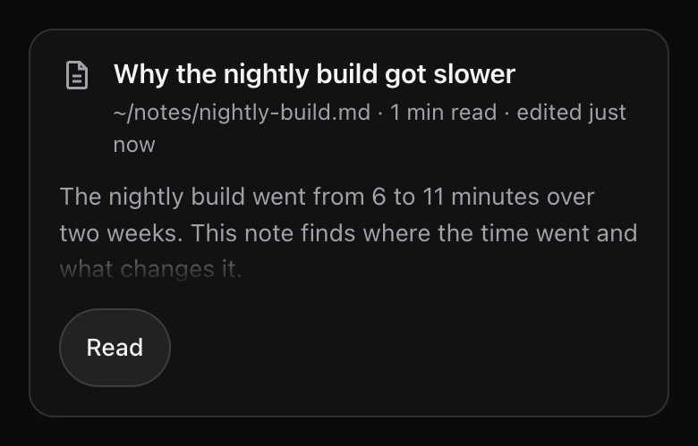
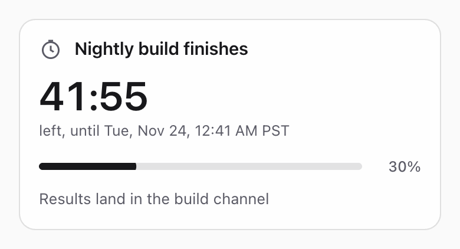
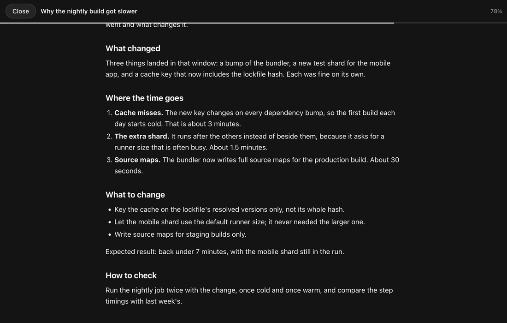
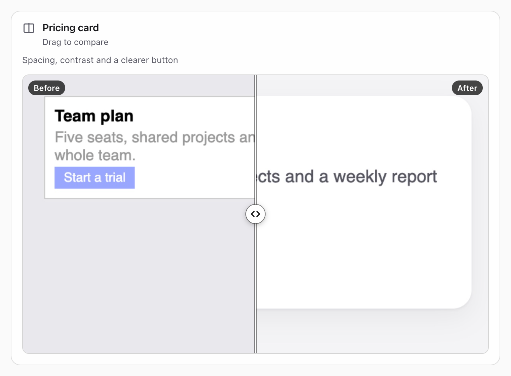

# t3-cards

Small interactive cards in the [T3 Code](https://github.com/pingdotgg/t3code) chat, on the desktop app and the phone
app. Any Claude Code session that has this MCP server can draw them. There is nothing to build into T3: T3 hosts
[MCP Apps](https://github.com/modelcontextprotocol/ext-apps) itself, so a tool that names a `ui://` page gets that page
drawn inline under its call.

<table>
<tr>
<td width="50%"></td>
<td width="50%"><br><br></td>
</tr>
</table>



## The four cards

| Tool | What it shows | When a session uses it |
|---|---|---|
| `show_document` | Title, path, read time, a short preview, and **Read**, which opens the whole file as an article with a reading progress bar (full screen on desktop). A file with a `Landing:` line and a `Verified:` list shows them as a checklist. | it hands you a markdown file to read |
| `show_progress` | A bar with "2 of 5" and a percentage, and each step as done, now, next, blocked or skipped | it reports work with 3 or more steps |
| `show_countdown` | A clock that keeps ticking, the end time in your time zone, and how much of the wait has passed | a deadline, a wait or a timed run matters |
| `show_compare` | Two stills with a drag handle and Before and After labels | it made before and after captures of a visual change |



Every state is a shape plus a word, never colour alone, and the bar's fill differs from its track in lightness with
a number beside it. Colours, fonts and light or dark come from the variables T3 sends the page
(`--color-text-primary` and the rest), so the cards follow your theme.

## Install

You need Node 18 or later, Claude Code, and a T3 Code build that hosts MCP Apps (tested on the T3 Code Nightly 0.1.8 desktop app
at phone and desktop widths).

```sh
git clone https://github.com/abhaymettu/t3-cards.git
cd t3-cards
./install.sh                         # registers it in your default Claude Code config
./install.sh ~/.claude-work          # or in one or more CLAUDE_CONFIG_DIR folders
./install.sh --uninstall             # removes it again
```

New Claude Code sessions pick it up; running sessions keep what they had.

Sessions learn when to draw a card from the server's MCP `instructions`, which Claude Code puts in the system prompt.
To use your own wording, put it in `instructions.local.md` next to `server.mjs`. That file is gitignored and replaces
the default text.

## How it works

1. Each tool's definition carries `_meta.ui.resourceUri: "ui://t3-cards/card"`.
2. After the call, T3's server reads that resource (`widget.html`) through the session and keeps a snapshot of it.
   Every T3 client draws the snapshot in a sandboxed iframe and passes it the tool result.
3. Heavy parts (a document's text, images) never go in the tool result, because Claude Code counts
   `structuredContent` against its output limit and shows it to the model. The server keeps them for ten minutes by
   card id and writes them into the page when T3 reads it, so each snapshot carries its own data and still draws after
   the session ends. The model sees one summary line.
4. `server.mjs` is a stdio MCP server with no dependencies; `widget.html` is the single page every card uses.

What T3 allows sets the limits: apps can open only http(s) links, the page is frozen at call time, and buttons that
call back to the server need the thread's session to be running. These cards use none of that.

`show_compare` downscales images with macOS `sips`, so it works on macOS only. The other three cards work anywhere
Node runs.

## Test

```sh
node --test test/
```

The tests check the protocol and that heavy data stays out of tool results. To check a change in T3 itself, open a T3
thread with this server, ask it to call each tool, and look at the cards at phone and desktop width, light and dark.

The stills above are the card page drawn by a small preview host that speaks the MCP Apps protocol, with demo content.

## Licence

MIT
